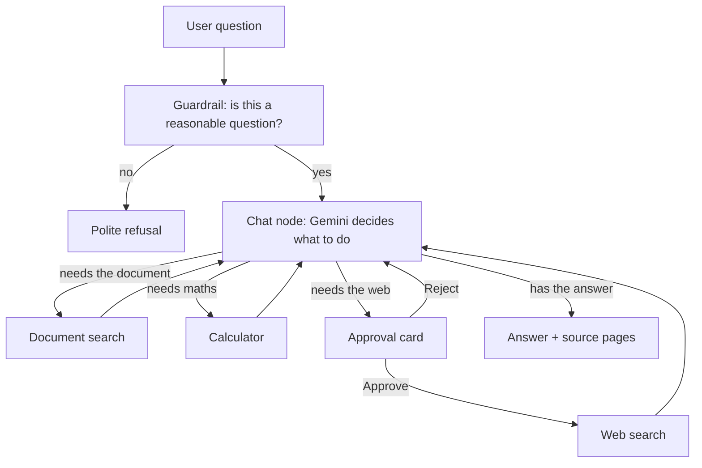
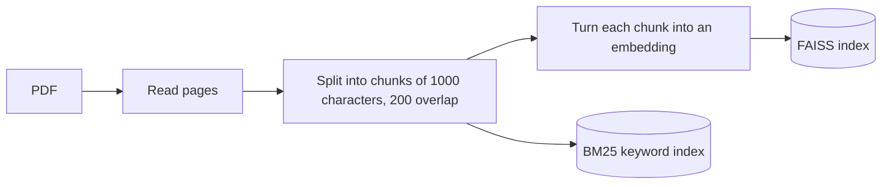
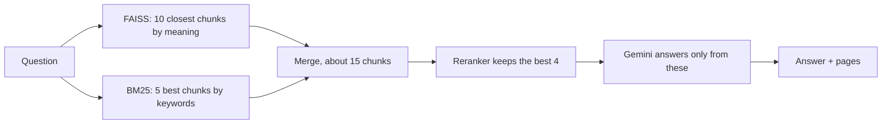
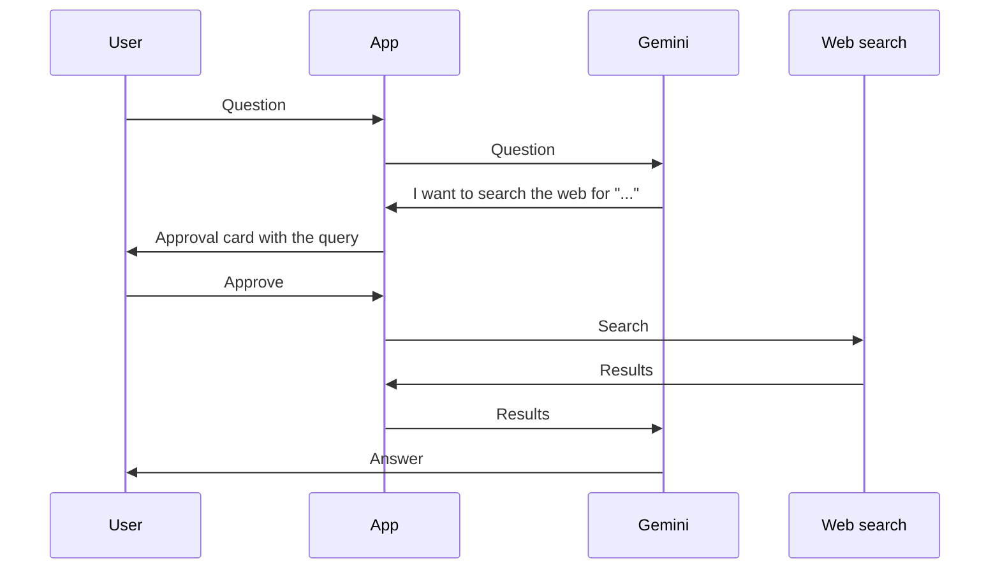

# RAG Chatbot

A chatbot that answers questions about a PDF you upload. It finds the relevant passages in the document, answers from them, and shows which pages it used. It can also do arithmetic and search the web, but every web search waits for your approval first.

Built with LangGraph, Streamlit and Google Gemini. It runs locally.

---

## What you can do with it

- **Upload a PDF**, or click **Load sample: OSHA energy safety rules** to try it with two public US safety regulations.
- **Ask questions** about the document. The answer streams in, with the source pages listed underneath.
- **Ask something the document doesn't cover**, and it says so instead of guessing.
- **Ask it to search the web.** It pauses and shows the search query; nothing is sent until you click **Approve**.
- **Switch between conversations** in the sidebar. Each one keeps its own document and history.

## How it works

### The overall flow



### When a PDF is uploaded



Ingestion runs in the background, and the sidebar shows each stage until it reads "Indexed …".

### When a question is answered



### Web search approval



If you click **Reject**, the model is told the search was declined and asks how you'd like to continue.

## Tech stack

| Part | Tool | Used for |
|---|---|---|
| Agent flow | LangGraph | The graph of steps, and pausing for approval |
| Language model | Google Gemini (free tier) | Writing answers and choosing tools |
| Embeddings | `all-MiniLM-L6-v2` (runs locally) | Turning chunks into vectors |
| Vector search | FAISS | Finding chunks by meaning |
| Keyword search | BM25 | Finding chunks by exact words |
| Reranker | `ms-marco-MiniLM-L-6-v2` (runs locally) | Picking the best 4 chunks |
| Storage | SQLite | Saving conversations |
| Web search | DuckDuckGo | Searching the web, after approval |
| Interface | Streamlit | The chat app |
| Evaluation | RAGAS | Scoring answers and retrieval |
| Tracing | LangSmith | Seeing each step of a run |
| Tests | pytest | 62 tests, no model calls |

## Quickstart

Tested with Python 3.14 on macOS. You need a free Google AI Studio API key.

```bash
git clone https://github.com/d4t4forge-debugX/RAG_Chat_Bot.git
cd RAG_Chat_Bot
python3 -m venv .venv
source .venv/bin/activate
pip install -r requirements-dev.txt
```

`requirements.txt` alone is enough to run the app; `requirements-dev.txt` adds what the evaluation scripts and tests need. If you plan to run the evaluation, also run `python -m scripts.patch_ragas` once (it fixes an import problem in `ragas==0.3.9`).

Create a `.env` file in the project folder:

```
GOOGLE_API_KEY=your_key_here
```

Run the app and the tests:

```bash
streamlit run streamlit_frontend.py
pytest -v
```

## Project structure

```
RAG_Chat_Bot/
├── streamlit_frontend.py     # The chat interface
├── langgraph_backend.py      # The graph: guardrail, chat, tools, approval
├── rag_utils.py              # PDF loading, search, reranker, sample documents
├── llm_config.py             # Which Gemini model to use
├── source_utils.py           # The "sources" line under answers
├── error_utils.py            # Readable error messages
├── ui_utils.py               # Conversation titles in the sidebar
│
├── demo_corpus/energy/       # Two OSHA regulations and their saved index
├── evals/                    # Evaluation scripts
│   └── questions/            # standard (24), hard (7), energy (11)
├── scripts/                  # build_demo_index.py, patch_ragas.py
├── tests/                    # 62 tests
├── docs/                     # One-page summary
│
├── requirements.txt          # App dependencies
├── requirements-dev.txt      # + evaluation and test dependencies
└── pytest.ini                # Tells pytest where the tests are
```

### Running the evaluation

Run these from the project folder (`-m` runs a file as part of the project, so it can import the app code):

```bash
python -m evals.verify_questions                    # every question's evidence is really in its PDF
python -m evals.evaluation --label my_run           # RAGAS scores, saved in eval_runs/
python -m evals.eval_hard                           # unanswerable and multi-passage questions
python -m evals.compare_rerank                      # search with and without the reranker (no model calls)
python -m evals.guardrail_eval                      # guardrail accuracy
```

Add `--questions-dir evals/questions/energy` to `evaluation` or `eval_hard` for the OSHA set. The evaluation PDFs other than the OSHA ones are not in the repository.

## Results

| What was measured | Result |
|---|---|
| Context precision (are the retrieved chunks relevant?), 24 questions | 0.86 (0.75 before adding the reranker) |
| Faithfulness (does the answer stay with the document?) | 0.99 |
| Answer relevancy (does it answer the question?) | 0.81 (0.87 before the reranker) |
| Questions the documents can't answer, correctly refused | 4/4, and 2/2 on the OSHA set |
| OSHA set: needed passages retrieved | 9/9 |
| Guardrail on 40 test messages | 39/40, no good questions blocked |
| Hidden instructions inside a document that changed the answer | 0/4 |

These are small, single-run evaluations on question sets I wrote myself, judged by a model from the same family as the one answering. They show direction, not precise scores.

## Limitations

- Single user, no login.
- Uploaded documents are kept in memory, so they're gone after a restart (the sample documents load from a saved index).
- One document per conversation.
- The free Gemini tier allows a limited number of requests per day.
- Web search results are not checked beyond your approval.
- Evaluation sets are small (24 + 7 + 11 questions).

## License

MIT, see [LICENSE](LICENSE).
