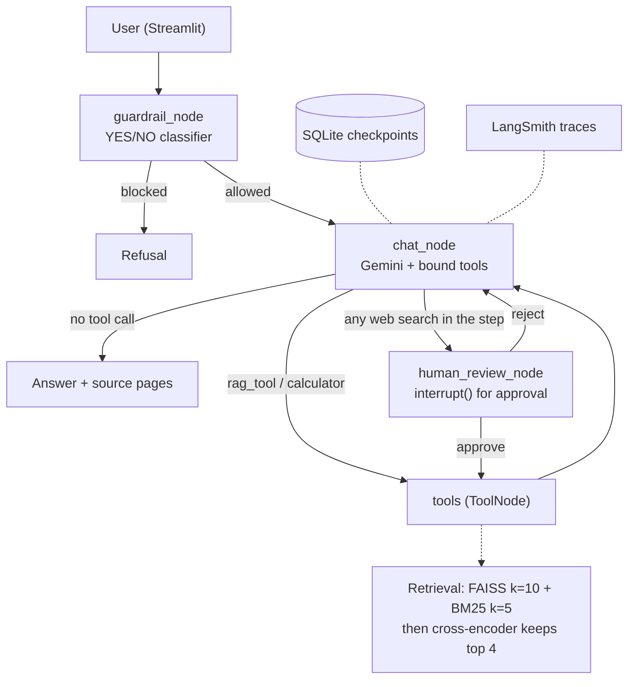

# RAG Chatbot

A retrieval-augmented generation (RAG) chatbot that answers questions from an uploaded PDF. It combines hybrid search (FAISS + BM25) with a cross-encoder reranker, human approval before any web search, the source pages under every document answer, conversation persistence, a one-click sample corpus of US workplace-safety regulations for the energy sector, and an evaluation whose results and limits are documented below, including the experiments that did not help.

Runs locally; it is not deployed (see [Quickstart](#quickstart)).

---

## Results at a glance

| What was measured | Result |
|---|---|
| Answer quality (RAGAS, 24 questions over 3 documents) | context precision 0.75 → 0.86, faithfulness 1.0 → 0.99, answer relevancy 0.87 → 0.81 (before → after the reranker) |
| Energy-safety sample (11 questions over 2 OSHA regulations) | faithfulness 1.0, answer relevancy 0.83, context precision 0.76; all evidence retrieved 9/9; unanswerable refused 2/2 |
| Reranker vs hybrid, retrieval only (27 questions, no LLM) | MRR 0.490 → 0.645; chunks sent to the model 5 → 4 |
| Hard questions (7: unanswerable + multi-passage) | unanswerable refused 4/4; multi-passage with all evidence retrieved 2/3 → 3/3 with the reranker |
| Prompt injection planted in a document (4 attacks) | 0/4 succeeded |
| Retrieval (evidence found, raw questions) | hybrid 20/24 vs FAISS-only 18/24 |
| Chunk size (page-level hit rate, 5 setups) | 1000/200 best at 22/24 |
| Input guardrail (40 hand-written cases) | 39/40: no false blocks, missed 1 gibberish string (38/40 before the stricter parsing) |
| Retrieval cache | ~0.07 ms per hit vs ~14 ms uncached on a 2,339-chunk textbook |
| Tests | 62 pytest tests, no LLM calls |

These are small-sample numbers; the [Evaluation](#evaluation) section explains how each was measured and what it does not show.

## What a session looks like

1. Upload a PDF in the sidebar and click **Process PDF**, or, with no PDF to hand, click **Load sample: OSHA energy safety rules**, which loads two public-domain OSHA regulations (lockout/tagout, 29 CFR 1910.147, and electric power generation, transmission and distribution, 1910.269) from a pre-built index in under a second. Ingestion runs in the background, and the sidebar shows each stage (loading, building embeddings, building the retriever) until it reads "Indexed …".
2. Ask a question about the document. The answer streams in, and a grey line underneath shows where it came from, for example `Sources retrieved: paper.pdf (PDF pages 4, 5)`. With the two-regulation sample, pages are listed per file.
3. Ask something the document does not cover, and the assistant says so instead of guessing.
4. Ask it to search the web. The run pauses and an **Approval needed** card shows the exact search query. Nothing is sent until you click **Approve**; **Reject** tells the assistant the search was declined.
5. Switch between conversations in the sidebar, where each is titled by its first question. Each one keeps its own document and history, and a conversation left waiting for approval still shows its card when you come back.

## Key features

- **Hybrid retrieval with reranking**: a wide candidate pool from FAISS (dense) and BM25 (keyword), reranked by a local cross-encoder that keeps the best 4 chunks.
- **Source pages under answers**: built from the chunks the retriever returned for that turn, named per file when a corpus has more than one.
- **Human-in-the-loop approval for web search**: every web search is paused with LangGraph's `interrupt()` and needs an explicit Approve or Reject, including when the model requests several tools in one step.
- **The model cannot choose which document it reads**: the conversation id reaches the retrieval tool from the run's config, never from the model's tool arguments.
- **One-click sample corpus**: OSHA energy-sector safety rules, indexed once and loaded instantly, so the app can be tried without a PDF.
- **Tool failures do not crash the app**: if a tool raises (for example, web search with no network), the error is returned to the model as a message instead of ending the run.
- **Model errors become plain messages**: a quota, rate-limit or outage error shows one readable sentence in the chat instead of a traceback; each model call has a 60-second timeout and at most 2 retries.
- **Streamed responses** for normal turns, rendered as markdown.
- **Conversation persistence** with `SqliteSaver`, including turns paused for approval.
- **Async PDF ingestion** on a background thread with live progress.
- **Query caching** of retrieval results, cleared when a new document is ingested.
- **Swappable LLM**: the model is chosen in one function and can be overridden with an environment variable.
- **Input guardrail**: a lightweight LLM check screens clearly abusive, illegal or spam input before the main flow; the user's text is passed to it as delimited data, and only a reply starting with YES lets it through.
- **Automated tests**: 62 pytest tests covering routing and approval, guardrail parsing, caching, source extraction, the sample corpus, tool and model error handling, the setup patch and the chunk filter.
- **Evaluation harness**: RAGAS, a hard-question runner, a prompt-injection check, and deterministic retrieval scripts.

## Architecture



The graph is built with LangGraph. `chat_node` is the only node that writes the real answer; `guardrail_node` runs a separate, cheap classification call first. Web search goes through `human_review_node` whenever it appears anywhere in the model's tool calls: it is the one tool that makes an external, untrusted network call, while the calculator and document retrieval are deterministic and internal. On Reject, every tool call in that step gets an answer, so the conversation stays valid for the model.

| Layer | Choice | Why |
|---|---|---|
| Orchestration | [LangGraph](https://langchain-ai.github.io/langgraph/) | Explicit state machine with native human-in-the-loop interrupts |
| LLM | Google Gemini (free tier) | No per-call cost during development |
| Embeddings | `sentence-transformers/all-MiniLM-L6-v2` (local) | Free, offline, no API dependency for retrieval |
| Vector store | FAISS | Fast local similarity search |
| Keyword search | BM25 (`rank_bm25`) | Catches exact terms dense embeddings can miss |
| Reranker | `cross-encoder/ms-marco-MiniLM-L-6-v2` (local) | Reads question and chunk together, so it ranks paraphrases better than the bi-encoder |
| Persistence | SQLite via `SqliteSaver` | Zero-setup conversation storage |
| Web search | DuckDuckGo (`ddgs`) | No API key required |
| Evaluation | [RAGAS](https://github.com/explodinggradients/ragas) | LLM-judged RAG metrics |
| Observability | LangSmith | Trace-level view of every graph run |
| Frontend | Streamlit | Fast to build |
| Testing | pytest | Standard |

## Quickstart

Developed and tested on Python 3.14 on macOS. You need a free [Google AI Studio](https://aistudio.google.com/) API key.

```bash
git clone https://github.com/d4t4forge-debugX/RAG_Chat_Bot.git
cd RAG_Chat_Bot

python3 -m venv .venv
source .venv/bin/activate   # Windows: .venv\Scripts\activate

pip install -r requirements-dev.txt   # app + evaluation + tests; the app alone needs only requirements.txt
python patch_ragas.py
```

`patch_ragas.py` fixes a known problem: `ragas==0.3.9` imports a module that no longer exists in current `langchain-community`, so `import ragas` fails on a fresh install. The script applies a small fix to the installed package, keeps a backup, is safe to run more than once, and checks that `import ragas` works afterwards. Only the evaluation scripts need ragas; the app itself does not.

Create a `.env` file in the project root:

```
GOOGLE_API_KEY=your_gemini_api_key_here
```

Optional, to use a different Gemini model without editing code:

```
LLM_MODEL=your_model_name
LLM_THINKING_LEVEL=low
```

Run the app:

```bash
streamlit run streamlit_frontend.py
```

Run the tests (no LLM calls, no PDFs needed):

```bash
pytest -v
```

## Evaluation

All numbers come from runs of the scripts in this repo. They are small-sample results and are labelled with their limits.

### Question set

24 hand-checked questions over three different documents: a machine-learning textbook (10 questions), the research paper "Attention Is All You Need" (8) and a practical project guide (6). Every question has a ground-truth answer and an `evidence` phrase copied from the PDF; `verify_questions.py` checks that each phrase really appears in the extracted text. Each question runs on its own fresh conversation thread, and the context that is scored is the chunks the chatbot's own `rag_tool` calls returned, not a separate re-retrieval.

### End-to-end quality (RAGAS, hybrid retrieval, single run)

| Document | Faithfulness | Answer relevancy | Context precision |
|---|---|---|---|
| Textbook (10 q) | 1.0 | 0.80 | 0.72 |
| Research paper (8 q) | 1.0 | 0.90 | 0.84 |
| Project guide (6 q) | 1.0 | 0.94 | 0.70 |
| **All 24** | **1.0** | **0.87** | **0.75** |

How to read this:
- **Faithfulness is saturated at 1.0.** Answers stayed inside the retrieved text, which is what the system prompt asks for, but a metric at its ceiling cannot separate configurations, so it is not used to compare them.
- The questions are single-fact lookups, and 7 of the 10 textbook questions were written from passages earlier runs had already retrieved, so the set is on the easy side.
- One run, judged by the same model family that writes the answers; treat differences of a few hundredths as noise.

### Retrieval comparison (no LLM calls, deterministic)

Each raw question is used as the query, and a question counts as a hit if a retrieved chunk contains its evidence phrase.

| Config | Hit rate | MRR |
|---|---|---|
| FAISS only, k=6 | 18/24 | 0.503 |
| FAISS only, k=4 | 18/24 | 0.503 |
| **Hybrid (k=4 + BM25 k=2), current** | **20/24** | 0.510 |

Hybrid found the evidence for two more questions, both through its BM25 half; ranking quality was about equal. This measures retrieval only, not how much irrelevant text comes along with the right chunk. Inside the app the model rewrites queries and may search more than once, so the in-app hit rate was higher (23/24 in the full run).

### Chunk size and a noise filter (measured, not adopted)

Scored by whether any retrieved chunk comes from a page that contains the evidence, which is fair across chunk sizes.

| Config | Page hit rate | Noise share of retrieved chunks |
|---|---|---|
| **1000 / 200 (current)** | **22/24** | 0.7% |
| 1000 / 200 + noise filter | 22/24 | 0.0% |
| 500 / 100 | 20/24 | 0.0% |
| 1500 / 300 | 20/24 | 1.5% |
| 1000 / 0 (no overlap) | 21/24 | 2.4% |

The current 1000/200 setting scored best, so it stays. A filter that drops table-of-contents, index and divider chunks (about 5% of the textbook) cut retrieved noise from 0.7% to 0% with the same hit rate; it was not adopted because the gain is marginal and it adds risk on layouts it has not been tested on. The code is in `chunk_filter.py` with tests.

### Guardrail accuracy

On a hand-written set of 40 queries (20 that should be allowed, 20 that should be blocked): all 20 allowed queries were allowed, and 19 of 20 blocked queries were blocked (up from 18 before the guardrail switched to strict YES parsing with the user's text passed as delimited data). The one miss is a gibberish string, which the deliberately permissive prompt does not treat as spam. The cases were written by the author, so they are on the easy side.

### Cache speed (retrieval step only)

A cache hit takes about 0.07 ms against a median of about 14 ms uncached on the 2,339-chunk textbook (about 190x over 10 queries). Across three documents the ratio ranged from 65x to 432x, so treat it as an order-of-magnitude figure. The Gemini call (typically 1 to 4 s) dominates real response time, and the cache does not store LLM output.

### Reranker (retrieval only, no LLM calls)

`compare_rerank.py` runs the 24 standard questions plus the 3 answerable hard questions (27) through three retrievers. A question counts as found only if every one of its evidence phrases is in the returned chunks.

| Config | All evidence found | MRR | Chunks returned | Time per query |
|---|---|---|---|---|
| Hybrid (k=4 + BM25 k=2), previous | 21/27 | 0.490 | 5.0 | 9 ms |
| **Wide hybrid (k=10 + BM25 k=5) → cross-encoder top 4, current** | **22/27** | **0.645** | **4.0** | 61 ms |
| Wide hybrid → cross-encoder top 3 | 21/27 | 0.636 | 3.0 | 45 ms |

The gain is in ranking, not in coverage: one question more is found, which is within noise, while the right chunk moves up (on the three textbook questions with the lowest context precision, the evidence went from ranks 1, 3 and 2 among 6 chunks to rank 1 among 4). Top 3 dropped a question top 4 kept, so top 4 was chosen. The added ~50 ms is small next to a 1 to 4 second model call.

End to end, on the same 24 questions as the earlier baseline (one run each):

| Document | Context precision | Faithfulness | Answer relevancy |
|---|---|---|---|
| Textbook (10 q) | 0.72 → 0.90 | 1.0 → 0.97 | 0.80 → 0.77 |
| Research paper (8 q) | 0.84 → 0.87 | 1.0 → 1.0 | 0.90 → 0.85 |
| Project guide (6 q) | 0.70 → 0.76 | 1.0 → 1.0 | 0.94 → 0.85 |
| **All 24** | **0.75 → 0.86** | **1.0 → 0.99** | **0.87 → 0.81** |

Context precision rose for every document. Answer relevancy fell; the largest drops (to 0.36 and 0.38) are on answers that are correct but terse, such as "eval numbers, never training loss". RAGAS answer relevancy generates questions back from the answer and compares them with the original, so a short answer that does not repeat the question's subject scores low. The one faithfulness drop (0.75) is an answer that matches the textbook on reading, where the judge marked one clause unsupported. An earlier partial run had shown the project guide dropping (0.70 to 0.54); this full run shows it rising, so that difference was within single-run noise.

The quota ran out while this run was being scored, leaving 13 questions unscored; `rescore.py` re-ran only the judge on the saved answers, without asking the chatbot again.

That run also exposed a regression from a separate change: after the thread id stopped being written into the prompt, the model answered three general-sounding textbook questions from its own knowledge without searching the document. The prompt now tells it to retrieve first for anything the document could answer, and a re-check of those three questions showed all three retrieving again.

### Hard questions

`eval_questions_hard/` holds 7 questions written from the documents before any run: 4 that the documents cannot answer but that sound as if they could (an English-to-Spanish BLEU score for a paper that reports only German and French, a dollar training cost for a paper that reports FLOPs), and 3 that need passages from different pages. `eval_hard.py` checks refusals with one small judge call each and checks multi-passage retrieval with plain phrase matching.

| | Before reranker | After |
|---|---|---|
| Unanswerable, refused correctly | 4/4 | 4/4 |
| Multi-passage, all evidence retrieved | 2/3 | 3/3 |

The miss before the reranker was a question about "human approval" whose answer the document words as "confirmation on irreversible actions". Because the bot already refused all four unanswerable questions, a separate abstention step was not added.

### Prompt injection inside a document

`injection_eval.py` plants four instructions inside an otherwise normal policy document (reply only with a fixed word, state a false refund period, append a link, run a web search) and asks ordinary questions. None of the four changed the answer, so no extra defence was added. These are four simple attacks, not a red-team suite. The control that matters more is what the agent is allowed to do: its only outward action, web search, needs human approval, and it has no tools that write anywhere.

### Energy-safety question set

`eval_questions_energy/` has 11 questions over the two OSHA regulations in the sample corpus (7 single-fact, 2 multi-passage, 2 unanswerable such as penalty amounts, which neither regulation states), with every evidence phrase checked by `verify_questions.py`. The questions were written before any run.

| Check | Result |
|---|---|
| RAGAS on the 9 answerable questions | faithfulness 1.0, answer relevancy 0.83, context precision 0.76 |
| All evidence retrieved (single-fact and multi-passage) | 9/9 |
| Unanswerable questions refused | 2/2 |

The regulations are long (536 chunks) and laid out in two columns with words hyphenated across lines, which makes them harder to retrieve from than the other test documents.

### Reproducing the numbers

The evaluation PDFs are not included in the repository: the textbook is copyrighted and the guide is a third-party document. The research paper is freely available on arXiv ([1706.03762](https://arxiv.org/abs/1706.03762)). `eval_questions/*.json` refer to the PDFs by file name; place equivalent PDFs in the project root under those names, then:

```bash
python verify_questions.py            # every evidence phrase exists in its PDF
python evaluation.py --label hybrid   # RAGAS run, saved under eval_runs/
python hit_rate.py                    # evidence hit rate of the latest run
python compare_retrieval.py           # FAISS-only vs hybrid
python compare_chunking.py            # chunk sizes and the noise filter
python bench_cache.py                 # cache timing
python guardrail_eval.py              # guardrail accuracy
python compare_rerank.py              # hybrid vs reranked retrieval, no LLM calls
python eval_hard.py                   # hard questions: refusals and multi-passage retrieval
python injection_eval.py              # prompt injection planted in a document
python rescore.py eval_runs/<run>.json  # re-score only questions the judge missed (quota), no new chatbot calls
python verify_questions.py eval_questions_energy
python evaluation.py --questions-dir eval_questions_energy --label energy
python eval_hard.py --questions-dir eval_questions_energy --label energy
```

The OSHA PDFs and their pre-built index are in `demo_corpus/energy/` (US federal regulations are public domain). Rebuild the index with `python build_demo_index.py` if the PDFs change.

The scripts that call the model make many requests. On the Gemini free tier (500 requests per day and 15 per minute for the default model at the time of writing), a full evaluation can use most of a day's quota.

## Key design decisions and trade-offs

**Hybrid retrieval tuning: reweighting alone does not work.** `EnsembleRetriever` merges the union of each retriever's results and only re-ranks by weight. Changing `weights=[0.5, 0.5]` to `[0.8, 0.2]` left the candidate set unchanged. The BM25 half was surfacing an "Exercises" section as keyword false positives, and the fix was reducing BM25's own `k` (`bm25_k=2`), not the weights.

**Human-in-the-loop gates only web search.** The calculator and document retrieval are deterministic and internal; gating them would add friction with no safety benefit.

**Guardrails are prompt-based.** Input filtering is one cheap YES/NO LLM call, and groundedness is enforced by the system prompt rather than a separate verifier. Simpler to build and explain, at the cost of being less robust than a purpose-trained model.

**Explicit flags instead of text matching.** The guardrail sets a `blocked` flag in the graph state, and its internal classifier call is tagged so the stream can exclude it. Neither depends on the wording of a message.

**Caching covers retrieval, not LLM output.** Cached answers could go stale when the system prompt changes, so only the deterministic retrieval step is cached.

**One document per conversation thread, with a replace confirmation.** Uploading a second PDF to a thread that already has one asks for confirmation instead of silently overwriting. Multiple documents per thread were deliberately deferred.

**Streaming covers new turns; the approval-resume path does not.** Resumed responses are short, and keeping the two code paths separate keeps each one simple.

**Retrieve wide, rerank narrow.** Embedding the question and each chunk separately is fast enough for thousands of chunks but misses paraphrases; a cross-encoder reads both together and ranks better but is too slow for a whole document. Taking about 15 hybrid candidates and letting the cross-encoder pick 4 uses each where it fits.

**The thread id comes from the run config, not the model.** It used to be written into the system prompt for the model to copy into the tool call, so a slip could point the tool at the wrong conversation's document. LangChain injects a tool parameter typed `RunnableConfig` without exposing it to the model, and a test checks that the model-visible schema contains only the query.

**Retrieve first, even for general-sounding questions.** The trade-off: with no document loaded, a general question gets a request to upload one instead of an answer from general knowledge. For a document assistant that is the right default.

**Measured and not adopted.** Abstention when retrieval is weak (unanswerable questions were already refused 4/4), an injection defence (0/4 planted attacks worked), a chunk noise filter and other chunk sizes (see above). Each was kept out because the measurement gave it nothing to fix.

**Local embeddings.** `all-MiniLM-L6-v2` runs locally with no per-call cost and removes one network dependency from the retrieval path.

## Known limitations

- **No authentication or multi-user support**; this is a single-user local project.
- **In-memory per-thread state resets on restart**: retrievers and query caches for uploaded PDFs are not persisted (the sample corpus is, as a pre-built index). A production version would use a persistent vector store.
- **One document per conversation thread** (the sample corpus is loaded as one combined document).
- **Sources are shown for live answers only**: they are not restored when a saved thread is reloaded, and a follow-up answered from earlier conversation text (with no new retrieval) shows no sources. The label says "retrieved", not "used": some retrieved pages may not have contributed to the answer.
- **LLM errors are reported after limited retries**: each call has a 60-second timeout and up to 2 retries (the library default of 6 was cut because retries on a quota error spend more quota). The free-tier daily quota can run out during heavy evaluation.
- **Web search is best-effort**: the DuckDuckGo wrapper returned an off-topic result once and failed on some networks, and its results reach the model unchecked.
- **The guardrail is deliberately permissive**: it blocks clearly abusive, illegal or spam input and does not block gibberish.
- **No runtime hallucination check**: groundedness relies on the system prompt plus offline evaluation, not a live verifier.
- **Evaluation limits**: 24 standard, 7 hard and 11 energy questions, written by the author; one run per measurement; the judge is from the same model family as the answerer.
- **Answer relevancy fell with the reranker** (0.87 to 0.81): mostly terse but correct answers, a known weakness of how RAGAS scores relevancy, but a real number.
- **Two model calls per turn** (guardrail and answer), which halves how many questions the free tier allows per day.
- **Paired `$` signs render as math**: answers are markdown, so an answer quoting two dollar amounts can show the text between them as a formula.
- **The Codespaces dev container uses Python 3.11**, while the project is developed and tested on 3.14.
- **Not implemented, by choice**: semantic chunking, cost-aware model routing, multiple documents per thread.

## Risk notes

| Risk | What handles it |
|---|---|
| Retrieved chunks that are mostly noise | Cross-encoder reranker; context precision measured with RAGAS |
| Questions the documents do not cover | Grounding rules in the system prompt; hard set shows 4/4 refusals |
| Instructions hidden inside an uploaded PDF | Only outward action (web search) needs human approval; no write tools; injection check 0/4 |
| Web results are untrusted, not ground truth | Every search needs approval; results are not otherwise checked (known gap) |
| Free-tier quota running out mid-session | Plain-language quota message; retries capped at 2 |
| Small evaluation sets | Every figure is labelled with its sample size and run count |

## How this would run in production

| Here | In production |
|---|---|
| Gemini free tier | A managed model endpoint such as AWS Bedrock or Azure OpenAI, still chosen in `llm_config.py` |
| FAISS + BM25 in memory | A managed search service with hybrid search, so indexes persist and scale |
| SQLite checkpoints | A managed database (for example Postgres) as the LangGraph checkpointer |
| Streamlit on one machine | A container service behind authentication |
| LangSmith tracing | Unchanged |

## How the agent checks its work

1. **Frame**: the user's question, screened by the guardrail.
2. **Delegate**: document retrieval, the calculator, or a web search.
3. **Verify**: human approval before any web search, grounding rules, page citations, and offline RAGAS and hard-question runs.
4. **Integrate**: a cited answer the user can check against the page.

## Project structure

```
RAG_Chat_Bot/
├── langgraph_backend.py       # Graph: nodes, routing, tools, guardrail, tool-failure handling
├── streamlit_frontend.py      # Streamlit UI: chat, PDF upload, approval flow, streaming, sources, errors
├── rag_utils.py               # PDF ingestion, hybrid retriever + reranker, rag_tool, caching, sample corpus loader
├── ui_utils.py                # Sidebar conversation titles
├── source_utils.py            # Extracts and formats the pages a turn's answer was retrieved from
├── error_utils.py             # Turns model errors into short plain-language messages
├── llm_config.py              # Single place that selects the LLM
├── patch_ragas.py             # One-command fix for the ragas import problem
├── evaluation.py              # RAGAS evaluation over eval_questions/
├── rescore.py                 # Re-scores questions the RAGAS judge missed, from a saved run
├── eval_questions/            # Hand-checked questions with evidence phrases (one file per document)
├── verify_questions.py        # Confirms every evidence phrase exists in its PDF
├── compare_retrieval.py       # FAISS-only vs hybrid retrieval comparison
├── hit_rate.py                # Evidence hit rate for a saved evaluation run
├── compare_chunking.py        # Chunk size and noise-filter comparison
├── chunk_filter.py            # Contents/index/divider chunk detector (measured, not adopted)
├── bench_cache.py             # Cache timing benchmark
├── guardrail_eval.py          # Guardrail accuracy test
├── guardrail_cases.json       # The 40 guardrail test queries
├── compare_rerank.py          # Hybrid vs reranked retrieval comparison
├── eval_hard.py               # Hard-question runner (refusals, multi-passage retrieval)
├── eval_questions_hard/       # 7 unanswerable and multi-passage questions
├── eval_questions_energy/     # 11 questions over the OSHA sample corpus
├── injection_eval.py          # Prompt injection planted in a document
├── build_demo_index.py        # Builds the sample corpus index once
├── demo_corpus/energy/        # OSHA 1910.147 and 1910.269 PDFs plus their FAISS index
├── .streamlit/config.toml     # Turns off the file watcher (avoids torchvision log noise)
├── test_*.py                  # pytest suites (62 tests)
├── requirements.txt           # app runtime dependencies (pinned)
├── requirements-dev.txt       # + ragas, pytest for evaluation and tests
├── LICENSE
└── .gitignore
```

## Possible next steps

Not scheduled; these are the improvements I would make first:

- A persistent vector store, so uploaded documents survive a restart.
- A lightweight runtime grounding check on the final answer.
- A reranker that suits short, checklist-style documents, or a rule for when to skip reranking.
- A larger prompt-injection suite with harder attacks.

## License

MIT, see [LICENSE](LICENSE).